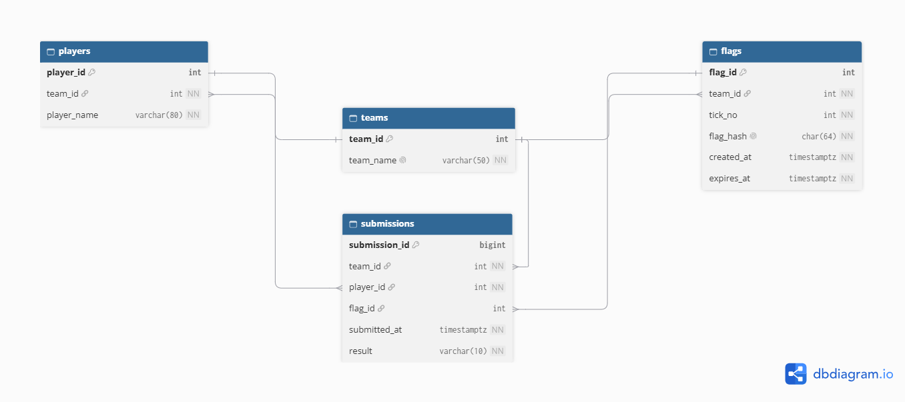

# MIT 8103 Advanced Database Systems

**AOT-CTF Attack-Defense CTF Competition** · Ubaydullah Onabanjo · Student ID 301907741

## Case study

AOT-CTF is a live Capture The Flag competition in the Attack-Defense CTF style. Ten teams take part, 4 players per team, and each gets its own copy of the same vulnerable web application (OWASP Juice Shop). Teams simultaneously launch offensive attacks against their rivals' vulnerable server to steal the secret flags, and fix the weaknesses in their own server so their flags cannot be stolen. The game runs in 96 five-minute ticks; a new flag is planted for every team each tick. A team scores +1 for each flag it captures and -1 for each of its own flags stolen.

The CTF event mirrors real-world security operations: attackers find a bug and weaponize it at scale to exploit vulnerable organisations, while defenders detect the attack and apply fixes and security controls under pressure, keeping downtime to the barest minimum.

The database keeps a record of every flag planted and every flag submitted. There must be correct validation of submissions for many submissions at once, while keeping the realtime leaderboard accurate. This makes AOT-CTF a practical case for database design, query performance, concurrency control, NoSQL and distributed databases.

## Portfolio 1: Database Design and Modelling

This database has been constructed using 4 tables: Teams, Players, Flags and Submissions. Primary keys identify the records and foreign keys connect the tables. Constraints ensure that the rules of the game are followed: each team has 1 flag per tick, ticks are between 1 and 96, flags have an expiry time and results must be 1 of the 5 allowed options. A two-column foreign key ensures that players cannot submit for other teams. A partial unique index on team_id and flag_id where the result is accepted ensures that each team can only capture a flag once. All flags are hashed using SHA-256. The database is in Third Normal Form and the score is calculated rather than stored. All 8 invalid inserts were denied and the sample data was unchanged.



Figure 1. Tables, keys and relationships.

Details and evidence: [Portfolio 1 README](portfolio-1-database-design/Onabanjo_Ubaydullah_301907741_P1_README.md)

## Portfolio 2: Query Processing and Optimisation

For this portfolio I generated a complete event with 960 flags and 200,000 submissions, in which each team patched at a different time. I wrote 4 queries to show the scoreboard, the number of captures per hour, the most attacked teams and the noisiest attackers in 1 tick. Once an index was added to the submitted_at column, the query for the noisiest attackers in 1 tick changed from a sequential scan to an index scan. This reduced the run time from 13.23 ms to 1.42 ms and the number of pages read from 1,706 to 28. Once a partial index was added for accepted submissions, the captures-per-hour query changed to an index-only scan, reducing the run time from 5.43 ms to 2.53 ms. The results from both phases were identical. These times will vary with the data and environment.

Details and evidence: [Portfolio 2 README](portfolio-2-query-optimisation/Onabanjo_Ubaydullah_301907741_P2_README.md)

## Portfolio 3: Transactions and Concurrency

I demonstrated COMMIT, ROLLBACK, automatic rollback and SAVEPOINT. I then submitted the same flag from 2 players on the same team in 2 different sessions. Without the unique index both captures were recorded and the team received 2 points. With the unique index in place, Session B had to wait for Session A to finish and then failed with a duplicate key error, leaving one capture. Using READ COMMITTED, the number of captures seen inside one transaction increased from 4 to 5, whereas using REPEATABLE READ it remained 5 until the transaction ended.

Details and evidence: [Portfolio 3 README](portfolio-3-transactions-concurrency/Onabanjo_Ubaydullah_301907741_P3_README.md)

## Portfolio 4: NoSQL and Advanced Data Models

The live scoreboard was modelled using a Redis sorted set. ZREVRANGE shows the top teams, ZREVRANK shows the rank of a team and ZINCRBY adds +1/-1 to a team's score after a capture. This avoids recalculating the scoreboard from 200,000 rows. A counter with a TTL of 60 seconds tracks each team's submission rate. Redis does not enforce any relational rules: after updating scores only in Redis, they no longer matched PostgreSQL. To fix this the sorted set was rebuilt from PostgreSQL, so PostgreSQL remains the source of truth.

Details and evidence: [Portfolio 4 README](portfolio-4-nosql/Onabanjo_Ubaydullah_301907741_P4_README.md)

## Portfolio 5: Distributed and Cloud Database Exercise

A Redis replica was added using Docker Compose. Changes made on the primary were reflected on the replica within 1 second, writes were denied on the replica, and when the primary was stopped the replica continued to serve the last scoreboard until the primary returned. For AOT-CTF, flag captures need strong consistency on the PostgreSQL primary, while the scoreboard can be eventually consistent and read from replicas. If multiple events were hosted on the platform, the data would be sharded by event, not by tick. Managed services such as Amazon RDS (Multi-AZ) and ElastiCache could provide failover and backups.

Details and evidence: [Portfolio 5 README](portfolio-5-distributed-cloud/Onabanjo_Ubaydullah_301907741_P5_README.md)

## Repository and evidence

| Folder | Contents |
|---|---|
| portfolio-1-database-design | ER diagram, schema, sample data, constraint tests, normalisation |
| portfolio-2-query-optimisation | data generator, queries, execution plans before and after indexes, results |
| portfolio-3-transactions-concurrency | commit, rollback and savepoint script; two-session race; isolation levels |
| portfolio-4-nosql | Redis leaderboard scripts, outputs and rebuild check |
| portfolio-5-distributed-cloud | Redis replica configuration, demonstration and discussion |
| docs/screenshots | all evidence screenshots |

Evidence files are named Onabanjo_Ubaydullah_301907741_P<portfolio>_<type>.

### How to run
1. Copy `.env.example` to `.env` and set the passwords.
2. Start the databases (PostgreSQL 17, Redis 7, MongoDB 7):
   ```bash
   docker compose up -d
   docker compose ps
   ```
3. Follow the "How to run" section in each portfolio README, in order 1 to 5.

## Individual reflection

I chose to create an Attack-Defense game because it produces a large number of automated submissions, which gave the concurrency work a realistic purpose. Testing with 2 sessions showed that a check in the application logic alone is not enough; the unique index in the database is what stops a team capturing the same flag twice. My initial generated data was unrealistic because every team had around 0 points, so I added a patching model, which showed that defence determined the ranking. I learnt that an index added for correctness can also improve performance, and that when data is duplicated in Redis there needs to be one source of truth.

## AI-use declaration

Claude (Anthropic) was used to plan, explain and write the scripts and README files. I ran all scripts in my environment and checked that they produced the correct outputs. I took all screenshots and wrote the final summary in my own words. I am responsible for ensuring the work has been checked and can be explained.

## References

- [OWASP Juice Shop (MIT licence): challenge list used as reference data](https://github.com/juice-shop/juice-shop)
- [PostgreSQL 17: constraints](https://www.postgresql.org/docs/17/ddl-constraints.html)
- [PostgreSQL 17: partial indexes](https://www.postgresql.org/docs/17/indexes-partial.html)
- [PostgreSQL 17: EXPLAIN](https://www.postgresql.org/docs/17/using-explain.html)
- [PostgreSQL 17: transaction isolation](https://www.postgresql.org/docs/17/transaction-iso.html)
- [Redis: sorted sets](https://redis.io/docs/latest/develop/data-types/sorted-sets/)
- [Redis: replication](https://redis.io/docs/latest/operate/oss_and_stack/management/replication/)
- [Docker Compose documentation](https://docs.docker.com/compose/)
