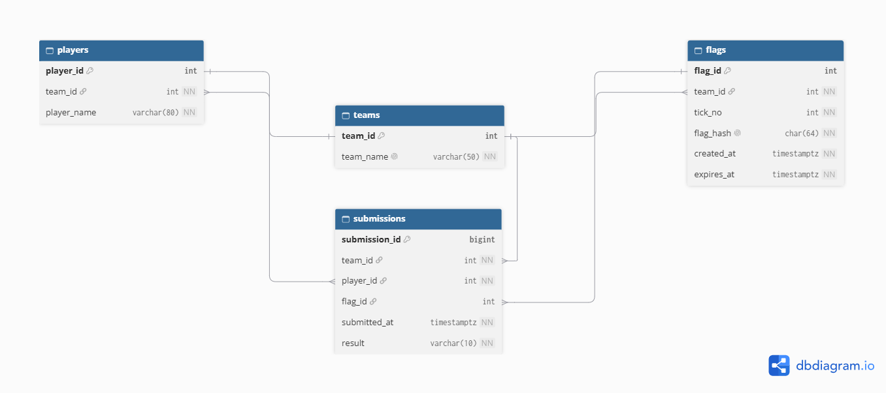
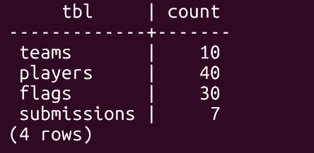
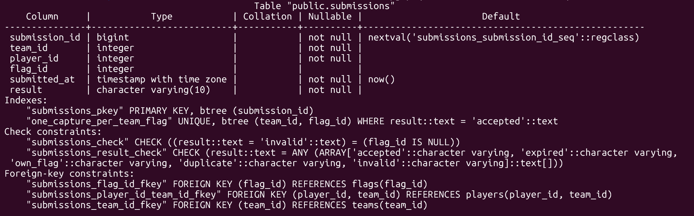
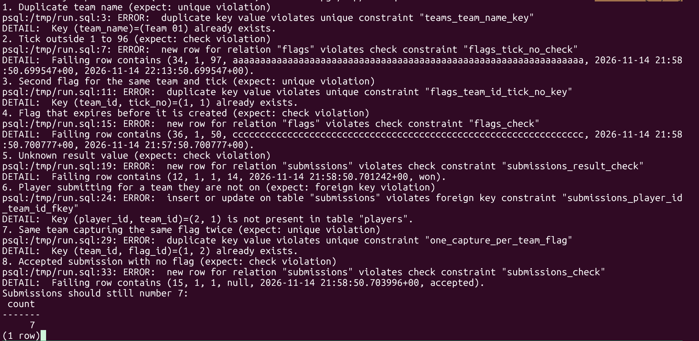

# Portfolio 1: Database Design and Modelling

Case study: AOT-CTF, an Attack-Defense Capture The Flag competition
(see [Onabanjo_Ubaydullah_301907741_P1_CaseStudy.md](Onabanjo_Ubaydullah_301907741_P1_CaseStudy.md)).

## Files
| File | Purpose |
|---|---|
| Onabanjo_Ubaydullah_301907741_P1_CaseStudy.md | The organisation, users, data and key operations |
| Onabanjo_Ubaydullah_301907741_P1_ERDiagram.png / Onabanjo_Ubaydullah_301907741_P1_ERDiagram.dbml | ER diagram and its source (dbdiagram.io) |
| Onabanjo_Ubaydullah_301907741_P1_Schema.sql | Creates the four tables, keys and constraints |
| Onabanjo_Ubaydullah_301907741_P1_SampleData.sql | 10 teams, 40 players, 30 flags, 7 submissions |
| Onabanjo_Ubaydullah_301907741_P1_ConstraintTests.sql | Eight inserts that break a rule and must be rejected |
| Onabanjo_Ubaydullah_301907741_P1_Normalisation.md | How the design reaches Third Normal Form |
| reference/ | OWASP Juice Shop challenge list and its source |

## Tables and relationships
- teams (team_id PK): one row per team; team names are unique.
- players (player_id PK, team_id FK): each player belongs to one team.
- flags (flag_id PK, team_id FK): one flag per team per tick (1-96), stored as a hash.
- submissions (submission_id PK, team_id FK, player_id FK, flag_id FK): every flag sent in, with its result.

A team has many players, owns many flags and makes many submissions.
A flag can be submitted many times. All relationships are one-to-many.



## How to run
```bash
docker compose up -d
docker exec -i aotctf-pg psql -U aotctf -d aotctf < portfolio-1-database-design/Onabanjo_Ubaydullah_301907741_P1_Schema.sql
docker exec -i aotctf-pg psql -U aotctf -d aotctf < portfolio-1-database-design/Onabanjo_Ubaydullah_301907741_P1_SampleData.sql
docker exec -i aotctf-pg psql -U aotctf -d aotctf < portfolio-1-database-design/Onabanjo_Ubaydullah_301907741_P1_ConstraintTests.sql
```

## Evidence
Sample data loaded:



Structure of the submissions table, with its keys and constraints:



Every rule rejects bad data, and the submission count stays at 7:



## Design decisions
1. Flags are stored only as SHA-256 hashes, so a leaked database does not reveal them.
2. A partial unique index (team_id, flag_id) WHERE result = 'accepted' means a team can capture each flag only once.
3. A two-column foreign key (player_id, team_id) stops a player submitting for a team they are not on.
4. Rows cannot be deleted while other rows depend on them, because competition records are an audit trail.
5. The check that a team is not submitting its own flag happens when the submission is processed, because it compares two tables.
6. Scores are calculated from submissions rather than stored (see Onabanjo_Ubaydullah_301907741_P1_Normalisation.md).
