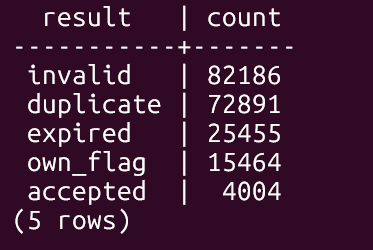
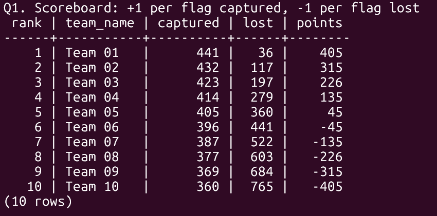
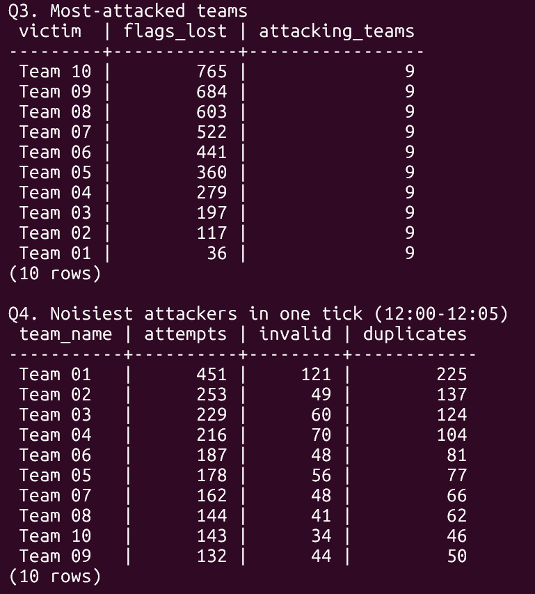
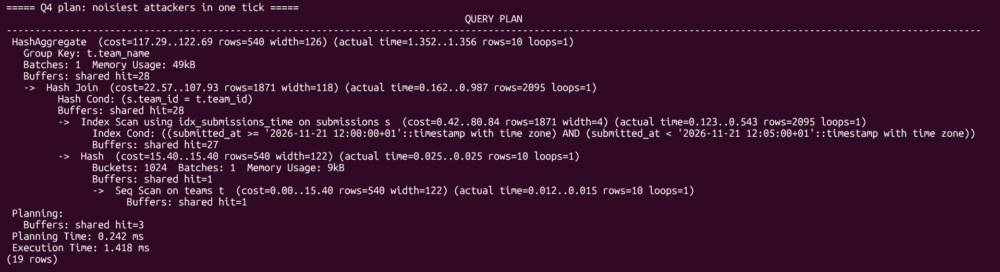

# Portfolio 2: Query Processing and Optimisation

Uses the Portfolio 1 schema with a full simulated 8-hour AOT-CTF event:
10 teams, 960 flags and 200,000 flag submissions.

## Files
| File | Purpose |
|---|---|
| Onabanjo_Ubaydullah_301907741_P2_GenerateData.sql | Builds the event: flags for 96 ticks and 200,000 submissions, including each team's patch time |
| Onabanjo_Ubaydullah_301907741_P2_Queries.sql | Four queries the competition needs |
| Onabanjo_Ubaydullah_301907741_P2_QueryResults.txt | Output of all four queries |
| Onabanjo_Ubaydullah_301907741_P2_Explain.sql | EXPLAIN (ANALYZE, BUFFERS) for Q2 and Q4 |
| Onabanjo_Ubaydullah_301907741_P2_Indexes.sql | The two indexes added |
| plans/Onabanjo_Ubaydullah_301907741_P2_PlanBefore.txt, plans/Onabanjo_Ubaydullah_301907741_P2_PlanAfter.txt | Execution plans before and after the indexes |
| Onabanjo_Ubaydullah_301907741_P2_Results.md | Performance analysis |

## The four queries
1. **Leaderboard**: +1 per flag captured, -1 per flag lost, ranked with RANK().
2. **Captures per hour**: per team, with a running total (window function).
3. **Most-attacked teams**: flags lost and how many teams attacked each one.
4. **Noisiest attackers in one tick**: attempts, invalid flags and duplicates in a 5-minute window.

## How to run
```bash
docker exec -i aotctf-pg psql -U aotctf -d aotctf < portfolio-1-database-design/Onabanjo_Ubaydullah_301907741_P1_Schema.sql
docker exec -i aotctf-pg psql -U aotctf -d aotctf < portfolio-1-database-design/Onabanjo_Ubaydullah_301907741_P1_SampleData.sql
docker exec -i aotctf-pg psql -U aotctf -d aotctf < portfolio-2-query-optimisation/Onabanjo_Ubaydullah_301907741_P2_GenerateData.sql
docker exec -i aotctf-pg psql -U aotctf -d aotctf < portfolio-2-query-optimisation/Onabanjo_Ubaydullah_301907741_P2_Queries.sql
docker exec -i aotctf-pg psql -U aotctf -d aotctf < portfolio-2-query-optimisation/Onabanjo_Ubaydullah_301907741_P2_Explain.sql
docker exec -i aotctf-pg psql -U aotctf -d aotctf < portfolio-2-query-optimisation/Onabanjo_Ubaydullah_301907741_P2_Indexes.sql
docker exec -i aotctf-pg psql -U aotctf -d aotctf < portfolio-2-query-optimisation/Onabanjo_Ubaydullah_301907741_P2_Explain.sql
```
Data is random, so exact counts and timings vary slightly between runs.

## Evidence
Data volume by result:



Scoreboard:



Most-attacked teams and noisiest attackers:



Q4 before the index (sequential scan of the whole table):


Q4 after the index (index scan of one tick only):



## Result in one line
Q4 went from 13.234 ms to 1.418 ms and from 1,706 pages read to 28; Q2 became
an index-only scan. Details are in [Onabanjo_Ubaydullah_301907741_P2_Results.md](Onabanjo_Ubaydullah_301907741_P2_Results.md).
