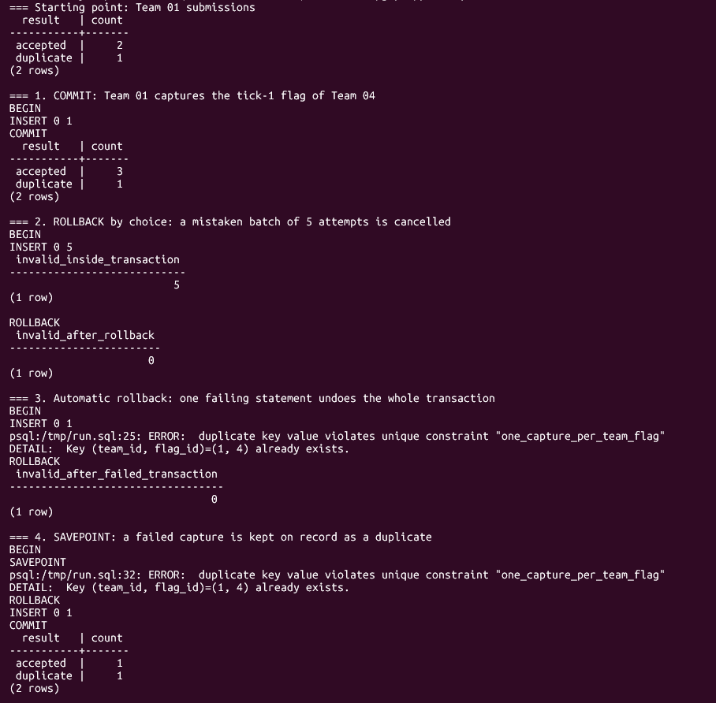
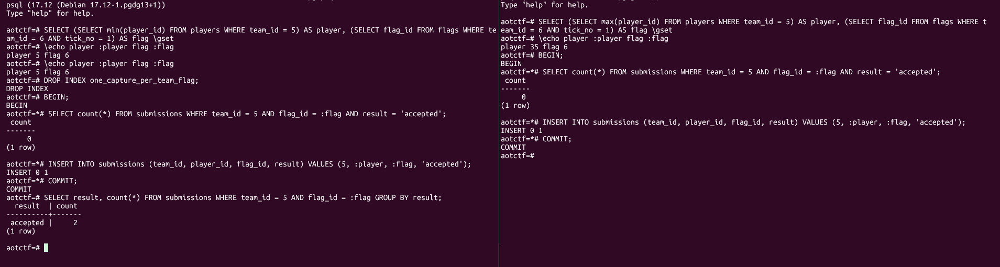
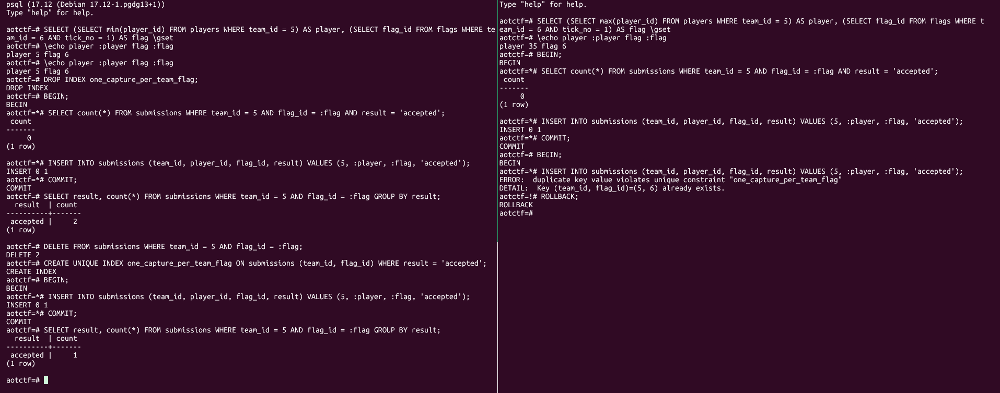
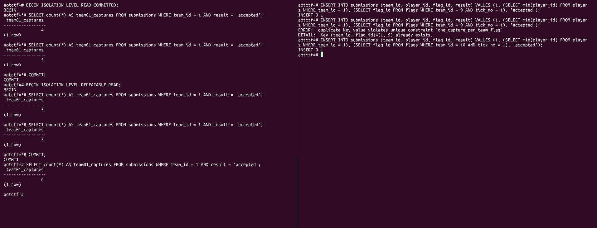

# Portfolio 3: Transactions and Concurrency

Uses the Portfolio 1 schema and sample data. The key protection is the
partial unique index one_capture_per_team_flag: a team can capture each
flag only once.

## How to run
```bash
docker exec -i aotctf-pg psql -U aotctf -d aotctf < portfolio-1-database-design/schema.sql
docker exec -i aotctf-pg psql -U aotctf -d aotctf < portfolio-1-database-design/sample-data.sql
docker exec -i aotctf-pg psql -U aotctf -d aotctf < portfolio-3-transactions-concurrency/commit-rollback.sql
```
The two-session tests are run by hand in two psql sessions
(`docker exec -it aotctf-pg psql -U aotctf -d aotctf`), following the steps below.

## 1. Commit, rollback and savepoint (commit-rollback.sql)
- COMMIT: a capture is saved (Team 01 accepted 2 -> 3).
- ROLLBACK by choice: 5 mistaken attempts exist inside the transaction, then disappear.
- Automatic rollback: one statement fails (a repeat capture), so PostgreSQL turns
  COMMIT into ROLLBACK and the earlier row in the same transaction is also undone.
  This is atomicity: all or nothing.
- SAVEPOINT: only the failed capture is undone; the attempt is then recorded as a
  duplicate and the transaction commits. This is how a submission service keeps a
  record of every attempt.



## 2. Two players submit the same flag at the same moment
Two sessions act as two Team 05 players submitting Team 06's tick-1 flag.

**Without protection** (unique index dropped):
1. Both sessions begin a transaction and check: the flag is not yet captured (0).
2. Both insert an accepted capture; both commit.
3. Result: accepted = 2. Team 05 scores twice for one flag. This is a
   check-then-insert race: each session's check was correct when it ran,
   but neither could see the other's uncommitted insert.



**With the unique index restored:**
1. Session A inserts the capture (not yet committed).
2. Session B inserts the same capture and waits, because PostgreSQL cannot
   decide whether B's row is a duplicate until A commits or rolls back.
3. A commits; B's insert fails with a duplicate key error and B rolls back.
4. Result: accepted = 1.

The database enforces the rule itself, so it holds however many players or
bots submit at once, without relying on application checks.



## 3. Isolation levels
Session A reads Team 01's capture count while session B commits new captures.
- READ COMMITTED (the default): A's count changed from 4 to 5 inside one
  transaction (a non-repeatable read).
- REPEATABLE READ: A saw 5 throughout, even after B committed; only after
  A's COMMIT did it see 6.

A scoreboard report that reads many rows should use REPEATABLE READ, so all
its numbers come from the same moment in the game.


