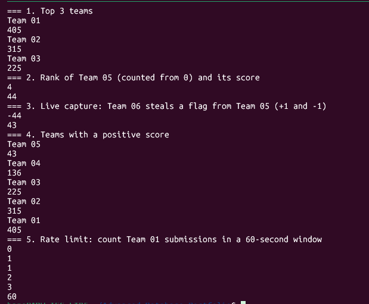
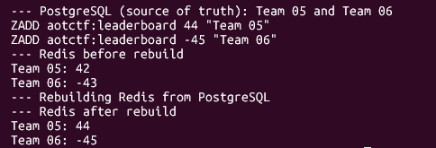

# Portfolio 4: NoSQL and Advanced Data Models

The same AOT-CTF event is modelled in Redis, a key-value store, as a live
leaderboard. PostgreSQL is the source of truth for every flag and
submission; Redis serves the scoreboard that players and viewers refresh
constantly.

## Data model
| Key | Redis type | Holds |
|---|---|---|
| aotctf:leaderboard | Sorted set | member = team name, score = points (+1 per flag captured, -1 per flag lost) |
| aotctf:rate:team01 | String counter with expiry | Team 01's submissions in the current 60-second window |

## Files
| File | Purpose |
|---|---|
| load-leaderboard.sql | Calculates each team's points in PostgreSQL and writes them as Redis ZADD commands |
| leaderboard-load-commands.txt | The commands that were loaded |
| leaderboard-demo.redis | Leaderboard operations: top 3, rank, live capture, positive scores, rate limit |
| leaderboard-demo-output.txt | Output of the demo |
| rebuild-check.sh | Compares Redis with PostgreSQL, rebuilds Redis, compares again |

## How to run
Load the Portfolio 2 event data first (portfolio-2-query-optimisation/generate-data.sql), then:
```bash
docker exec aotctf-redis redis-cli DEL aotctf:leaderboard
docker exec -i aotctf-pg psql -U aotctf -d aotctf -At < portfolio-4-nosql/load-leaderboard.sql | docker exec -i aotctf-redis redis-cli
docker exec -i aotctf-redis redis-cli < portfolio-4-nosql/leaderboard-demo.redis
bash portfolio-4-nosql/rebuild-check.sh
```

## Evidence
Leaderboard operations:



Redis drifts from PostgreSQL after updates made only in Redis, and is rebuilt to match:



## Why a key-value sorted set suits the leaderboard
- **Reads dominate.** During the game every player and viewer refreshes the
  scoreboard. In PostgreSQL, each refresh recalculates points from 200,000
  submissions (Portfolio 2, Q1). Redis keeps the ranking ready, so the top 10 or
  a team's rank is a single lookup (ZREVRANGE, ZREVRANK).
- **Updates are tiny.** A capture changes two scores by +1 and -1 (ZINCRBY),
  and Redis keeps the order sorted automatically.
- **Short-lived counters.** Rate limiting makes use of a counter that resets itself;
  INCR with EXPIRE does this without any cleanup job.
- **Speed.** Redis keeps the data in memory, so these operations take
  microseconds.

## Limits and trade-offs
- Redis does not enforce relationships or constraints. It cannot stop a
  double capture; the unique index in PostgreSQL does that (Portfolio 3).
- Data held in two places can drift. Here the demo capture updated Redis only,
  and the scores no longer matched PostgreSQL. The rule is: PostgreSQL is the
  source of truth, Redis is a fast copy that can always be rebuilt from it
  (rebuild-check.sh).
- Memory is limited, so Redis holds only the small, hot data (10 scores and
  counters), not the full submission history.
- In a real system each accepted submission would be committed in PostgreSQL
  first, then applied to Redis with ZINCRBY, with a periodic rebuild as a
  safety net.

