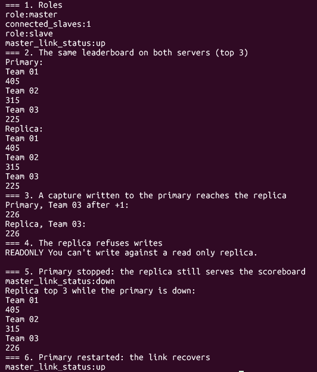

# Portfolio 5: Distributed and Cloud Databases

How AOT-CTF would run as a distributed system: a working Redis replica,
plus a design discussion of replication, sharding, consistency, availability
and cloud deployment.

## Setup: Redis primary and replica
A second Redis server (aotctf-redis-replica) copies the leaderboard from the
main Redis server automatically.

```bash
docker compose -f docker-compose.yml -f portfolio-5-distributed-cloud/docker-compose.replica.yml up -d redis-replica
bash portfolio-5-distributed-cloud/replication-demo.sh
```

What the demonstration shows:
1. One primary and one replica, linked.
2. Both hold the same leaderboard.
3. A capture written to the primary appears on the replica within a second.
4. The replica refuses writes, so scores change in one place only.
5. With the primary stopped, the replica still serves the scoreboard
   (availability), but no new captures can be recorded until it returns.
6. When the primary restarts, the replica reconnects.



## Replication
- **PostgreSQL:** one primary takes every write (flags and submissions).
  Streaming replicas copy it and serve read-heavy work such as the Portfolio 2
  reports, so these do not slow down flag submission.
- **Redis:** replicas (as above) serve the scoreboard to many viewers at once.
- Replication is asynchronous by default, so a replica can be slightly behind
  the primary.

## Consistency: what must be exact, and what may lag
| Data | Needs | Why |
|---|---|---|
| Flag captures | Strong consistency, on the PostgreSQL primary only | A capture must be checked against all earlier captures (the Portfolio 3 unique index); two servers deciding separately could both accept the same flag |
| Live scoreboard | Eventual consistency is acceptable | A score a second or two old does no harm, and Redis can be rebuilt from PostgreSQL (Portfolio 4) |
| Reports and statistics | Eventual consistency is acceptable | Read from a replica, using REPEATABLE READ for a consistent snapshot (Portfolio 3) |

## Availability and the CAP trade-off
If the network splits, a distributed system must choose between staying
available and staying consistent.
- **Submissions choose consistency:** if the primary is unreachable, it is
  better to pause scoring briefly than to accept a capture twice.
- **The scoreboard chooses availability:** as the demonstration shows, viewers
  keep seeing the last known scores while the primary is down.
- Automatic failover (Redis Sentinel, or a PostgreSQL tool such as Patroni)
  would promote a replica to primary so scoring resumes quickly.

## Sharding
One event (10 teams, 200,000 submissions) fits easily on one server. A
platform hosting many events at once might split the data:
- **By event:** each event's teams, flags and submissions on one shard.
  Captures always compare a team with flags from the same event, so the
  uniqueness check stays on one shard.
- **Not by time (tick):** every submission arrives at the current tick, so one
  shard would take all the writes while the others sat idle (a hotspot).
- **Within a very large event:** sharding submissions by a hash of the
  attacking team spreads the writes evenly, because each team's captures stay
  together on one shard and the one-capture rule can still be checked there.

## Cloud deployment
| Part | Managed service example | What it adds |
|---|---|---|
| PostgreSQL | Amazon RDS for PostgreSQL (Multi-AZ), Azure Database for PostgreSQL, Google Cloud SQL | Standby in another data centre with automatic failover, backups, read replicas |
| Redis | Amazon ElastiCache, Azure Cache for Redis, Google Memorystore | Managed replicas and automatic failover |

For a one-day event, the database can be created before the competition and
removed afterwards, keeping costs to the event day. The data stays in the
region closest to most players for low latency, and all connections use TLS.
